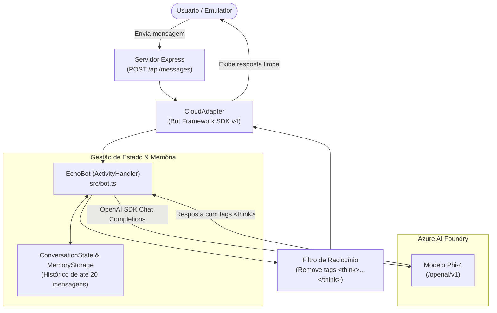

# 🤖 Chatbot Inteligente com Bot Framework SDK v4 e Azure AI Foundry (Phi-4)

Este projeto implementa um chatbot inteligente e contextual para o ecossistema **Microsoft Bot Framework SDK v4**, desenvolvido com **Node.js (v24)** e **TypeScript**, utilizando **Express** como servidor HTTP e alimentado pelos modelos de linguagem da família **Phi-4** (com suporte nativo ao modelo de raciocínio `Phi-4`) hospedados no **Azure AI Foundry**.

---

## 📌 Sumário
- [Arquitetura da Solução](#-arquitetura-da-solução)
- [Tecnologias Utilizadas](#-tecnologias-utilizadas)
- [Principais Funcionalidades](#-principais-funcionalidades)
- [Pré-requisitos](#-pré-requisitos)
- [Instalação e Configuração](#-instalação-e-configuração)
  - [1. Clonar e Navegar no Repositório](#1-clonar-e-navegar-no-repositório)
  - [2. Instalação das Dependências](#2-instalação-das-dependências)
  - [3. Configuração das Variáveis de Ambiente](#3-configuração-das-variáveis-de-ambiente)
- [Compilação e Execução](#-compilação-e-execução)
- [Como Testar com o Bot Framework Emulator](#-como-testar-com-o-bot-framework-emulator)
- [Comandos Disponíveis no Chat](#-comandos-disponíveis-no-chat)
- [Estrutura de Arquivos](#-estrutura-de-arquivos)
- [Tratamento de Raciocínio (Phi-4-reasoning)](#-tratamento-de-raciocínio-phi-4-reasoning)
- [Tratamento de Erros e Resiliência](#-tratamento-de-erros-e-resiliência)

---

## 🏗 Arquitetura da Solução

O fluxo da solução conecta o canal do usuário (como o **Bot Framework Emulator**, Microsoft Teams ou WebChat) ao servidor HTTP via **Express**, processa as atividades por meio do **CloudAdapter** do Bot Framework SDK v4 e orquestra as interações e histórico de sessão com a API do **Azure AI Foundry**.



### Detalhes dos Componentes:

1. **Servidor HTTP (Express - `src/index.ts`)**:
   - Inicializa a aplicação Express na porta configurada (padrão `3978`).
   - Habilita o middleware `express.json()` para parsing de payloads JSON.
   - Expõe o endpoint `POST /api/messages`, direcionando as requisições para o pipeline do `CloudAdapter`.

2. **Adaptador do Bot Framework (`CloudAdapter`)**:
   - Gerencia a autenticação com as credenciais da Microsoft (`ConfigurationBotFrameworkAuthentication`).
   - Orquestra os turnos de conversação e captura exceções não tratadas por meio do manipulador global `adapter.onTurnError`.

3. **Gerenciamento de Estado de Conversa (`ConversationState`)**:
   - Utiliza `MemoryStorage` para armazenar o estado em memória (sessão local).
   - Registra um acessor de propriedade (`conversationHistoryProperty`) responsável por manter uma janela deslizante das últimas mensagens trocadas.

4. **Lógica do Bot (`EchoBot` - `src/bot.ts`)**:
   - Subclasse de `ActivityHandler`.
   - Gerencia mensagens recebidas (`onMessage`), comandos de controle (`/limpar`) e eventos de entrada de novos participantes (`onMembersAdded`).
   - Envia indicadores visuais de digitação (`typing`) enquanto a resposta do LLM está sendo gerada.
   - Salva automaticamente as alterações de estado no final de cada ciclo através do método `run()`.

5. **Azure AI Foundry & Cliente OpenAI**:
   - Estabelece comunicação via SDK oficial `openai` apontando para o endpoint base `/openai/v1` do Azure AI Foundry.
   - Envia o prompt de sistema em conjunto com o histórico recente de mensagens.
   - Suporta modelos de raciocínio profundo como `Phi-4-reasoning` e modelos de instrução como `Phi-4-mini-instruct`.

---

## 🚀 Tecnologias Utilizadas

| Tecnologia | Versão | Papel no Projeto |
| :--- | :--- | :--- |
| **Node.js** | `v24.x` | Ambiente de execução JavaScript do lado do servidor |
| **TypeScript** | `v7.x` / `v5.x` | Linguagem fortemente tipada para compilação segura |
| **Express** | `^5.3.0` | Framework web HTTP rápido e minimalista |
| **Bot Framework SDK v4 (`botbuilder`)** | `~4.22.1` | SDK oficial da Microsoft para orquestração de bots e turnos |
| **OpenAI SDK (`openai`)** | `^7.57.0` | Cliente para integração com o endpoint REST do Azure AI Foundry |
| **dotenv** | `~8.2.0` | Carregamento de variáveis de ambiente a partir de arquivo `.env` |
| **Nodemon** | `^2.0.4` | Monitoramento e reinicialização automática durante o desenvolvimento |

---

## ✨ Principais Funcionalidades

- **Processamento de Raciocínio (Reasoning CoT)**: Trata as respostas geradas por modelos como o `Phi-4-reasoning`, eliminando as tags internas de pensamento (`<think>...</think>`), entregando ao usuário exclusivamente a resposta final direta.
- **Histórico Contextual**: Mantém o contexto de até **20 mensagens recentes** por conversa, permitindo diálogos fluidos com memória de curto prazo.
- **Comando `/limpar`**: Permite resetar o histórico da conversa a qualquer momento diretamente pelo chat.
- **Indicador de Digitação**: Envia eventos do tipo `typing` ao canal para manter o usuário ciente de que o bot está processando a resposta.
- **Mensagem de Boas-Vindas**: Apresentação inicial automática no evento `onMembersAdded` para orientar novos usuários.
- **Resiliência a Erros**: Fallback amigável caso ocorram falhas na comunicação com a API do Azure ou exceções internas.

---

## 📋 Pré-requisitos

Antes de iniciar, certifique-se de ter instalado em sua máquina:

1. **[Node.js v24+](https://nodejs.org/)** (e o gerenciador de pacotes `npm`).
   ```bash
   node -v   # Ex: v24.x.x
   npm -v    # Ex: 10.x.x ou 11.x.x
   ```
2. **[Bot Framework Emulator](https://github.com/microsoft/BotFramework-Emulator/releases)** instalado para depuração e testes locais.
3. **Recurso no Azure AI Foundry**:
   - Um endpoint ativo do modelo **Phi-4** (como `Phi-4-reasoning` ou `Phi-4-mini-instruct`).
   - Endpoint no formato: `https://<seu-recurso>.services.ai.azure.com/openai/v1`
   - Chave de API correspondente.

---

## ⚙️ Instalação e Configuração

### 1. Clonar e Navegar no Repositório

```bash
git clone <URL_DO_REPOSITORIO>
cd chatbot-typescript/chatbot
```
*(Se estiver operando diretamente na raiz do workspace, posicione-se no diretório do bot onde reside o `package.json`).*

### 2. Instalação das Dependências

Instale todos os pacotes necessários via npm:

```bash
npm install
```

### 3. Configuração das Variáveis de Ambiente

Crie um arquivo `.env` na raiz do diretório do bot. Você pode duplicar o modelo disponibilizado em `.env.example`:

```bash
# No Windows PowerShell:
Copy-Item .env.example .env

# No Linux/macOS:
cp .env.example .env
```

Edite o arquivo `.env` com as suas credenciais:

```ini
# Porta do Servidor Web
PORT=3978

# Credenciais Microsoft Bot Framework (deixe em branco para testes locais no Emulator)
MicrosoftAppId=
MicrosoftAppPassword=
MicrosoftAppType=
MicrosoftAppTenantId=

# Configurações do Azure AI Foundry
AZURE_PHI_ENDPOINT=https://<seu-recurso>.services.ai.azure.com/openai/v1
AZURE_PHI_API_KEY=sua_chave_de_api_aqui
AZURE_PHI_MODEL=Phi-4-reasoning
```

#### Descrição das Variáveis:

| Variável | Obrigatória | Padrão | Descrição |
| :--- | :---: | :---: | :--- |
| `PORT` | Não | `3978` | Porta TCP em que o servidor Express escutará. |
| `MicrosoftAppId` | Não | `""` | ID do aplicativo no Azure Bot Service (em branco para modo local). |
| `MicrosoftAppPassword` | Não | `""` | Segredo do aplicativo no Azure Bot Service (em branco para modo local). |
| `AZURE_PHI_ENDPOINT` | **Sim** | - | Endpoint OpenAI-compatible do Azure AI Foundry (terminando em `/openai/v1`). |
| `AZURE_PHI_API_KEY` | **Sim** | - | Chave de autenticação gerada no portal do Azure AI Foundry. |
| `AZURE_PHI_MODEL` | Não | `Phi-4-reasoning` | Nome do modelo implantado (ex: `Phi-4-reasoning`, `Phi-4-mini-instruct`). |

---

## 💻 Compilação e Execução

Os seguintes scripts estão configurados no `package.json`:

### Modo de Desenvolvimento (com Hot-Reload)
Inicia o compilador TypeScript e reinicia o servidor automaticamente a cada alteração no diretório `src/`:
```bash
npm run watch
```

### Compilação (Build)
Gera os arquivos JavaScript compilados na pasta `./lib`:
```bash
npm run build
```

### Execução em Produção
Compila o projeto e inicia o servidor Express:
```bash
npm run start
```

Ao iniciar, você verá no terminal a mensagem:
```text
Servidor Express rodando em http://localhost:3978
```

---

## 🧪 Como Testar com o Bot Framework Emulator

O **Bot Framework Emulator** permite testar e debugar conversas localmente de forma simples:

1. **Inicie o servidor do bot** no terminal:
   ```bash
   npm run watch
   ```
2. **Abra o Bot Framework Emulator** instalado em seu computador.
3. Clique no botão **"Open Bot"** na tela inicial (ou no menu superior: `File` -> `Open Bot`).
4. Preencha o campo **Bot URL**:
   ```text
   http://localhost:3978/api/messages
   ```
5. **Mantenha os campos `Microsoft App ID` e `Microsoft App Password` totalmente vazios** (já que o bot está rodando em modo de emulação local sem autenticação).
6. Clique no botão **"Connect"**.
7. O bot enviará a mensagem de boas-vindas:
   > *"Olá! Sou seu assistente rodando com Phi-4-reasoning no Azure. Digite /limpar para reiniciar a conversa."*
8. Envie qualquer pergunta ou comando no chat para testar a integração com o modelo Phi-4.

> [!TIP]
> Caso queira inspecionar os pacotes JSON trocados entre o Emulador e o Bot, clique sobre qualquer balão de mensagem no emulador para abrir o painel lateral **JSON Inspector**.

---

## 💬 Comandos Disponíveis no Chat

| Comando / Ação | Gatilho | Descrição |
| :--- | :--- | :--- |
| **`/limpar`** | Mensagem de texto `/limpar` (sem distinção de maiúsculas) | Reseta imediatamente todo o histórico acumulado na sessão atual. O bot responde: *"Histórico apagado. Como posso ajudar?"*. |
| **Boas-Vindas** | Entrada de novo participante (`onMembersAdded`) | Envia a saudação inicial orientando o usuário sobre o modelo em uso e os comandos disponíveis. |
| **Conversação Geral** | Qualquer texto livre | Adiciona o texto ao histórico, envia sinal de digitação (`typing`), consulta o Azure AI Foundry e responde mantendo o contexto da conversa. |

---

## 🧠 Tratamento de Raciocínio (Phi-4-reasoning)

Modelos de raciocínio profundo (*reasoning models*) como o `Phi-4-reasoning` produzem blocos internos de raciocínio (Chain-of-Thought) delimitados por tags `<think> ... </think>`. 

Para evitar que essas reflexões brutas e passos intermediários cheguem ao usuário, o método `onMessage` em `src/bot.ts` realiza uma higienização inteligente:

```typescript
// Extrai somente o que vem após </think> (mesmo sem a tag de abertura <think>)
let respostaLimpa = textoBruto;
const indexFechamento = textoBruto.lastIndexOf('</think>');
if (indexFechamento !== -1) {
    respostaLimpa = textoBruto.substring(indexFechamento + 8).trim();
} else {
    respostaLimpa = textoBruto.replace(/<think>[\s\S]*?<\/think>/gi, '').trim();
}
```

Isso garante que o usuário receba apenas a conclusão clara, direta e objetiva gerada pelo modelo.

---

## 🛡 Tratamento de Erros e Resiliência

1. **Erros de Turno (`onTurnError` em `src/index.ts`)**:
   - Captura falhas inesperadas no ciclo de vida do Bot Framework.
   - Registra o erro no console e notifica o usuário amigavelmente com `"O bot encontrou um erro interno."`.
2. **Falhas de Conexão com Azure AI Foundry (`try/catch` em `src/bot.ts`)**:
   - Em caso de timeout, problemas de rede ou chaves inválidas, a exceção é interceptada.
   - O bot responde com `"Desculpe, ocorreu um erro ao processar sua solicitação."`, impedindo a queda da aplicação.

---

## 📁 Estrutura de Arquivos

```text
chatbot-typescript/
├── chatbot/
│   ├── deploymentScripts/     # Scripts de preparação para deploy no Azure
│   ├── deploymentTemplates/   # Modelos ARM para provisionamento de recursos
│   ├── src/
│   │   ├── index.ts           # Ponto de entrada: Servidor Express e CloudAdapter
│   │   └── bot.ts             # Classe EchoBot: Regras de negócio e integração Azure
│   ├── .env.example           # Modelo das variáveis de ambiente
│   ├── .gitignore             # Arquivos ignorados pelo controle de versão
│   ├── package.json           # Dependências e scripts do projeto
│   ├── tsconfig.json          # Configurações do compilador TypeScript
│   ├── tslint.json            # Configurações de linter
│   └── README.md              # Documentação oficial do projeto
└── README.md                  # Documentação na raiz do workspace
```

---

## 📄 Licença

Este projeto está sob a licença [MIT](LICENSE).
